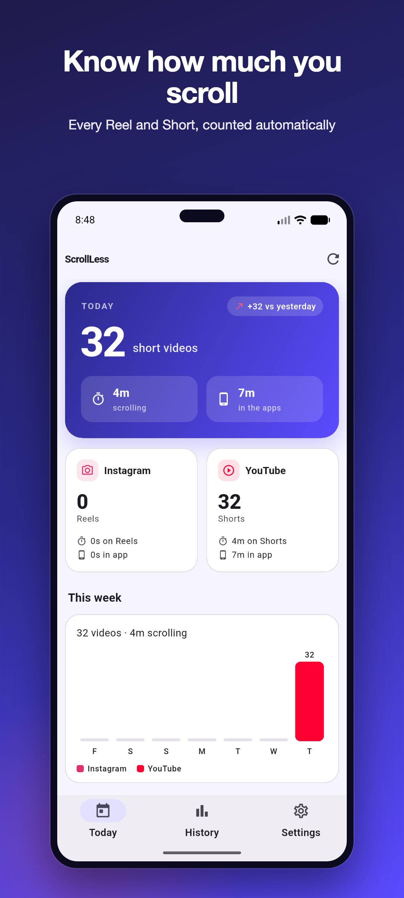
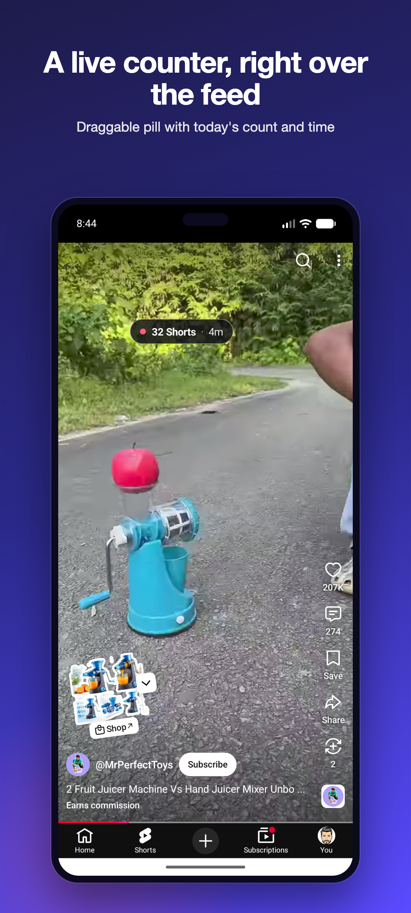
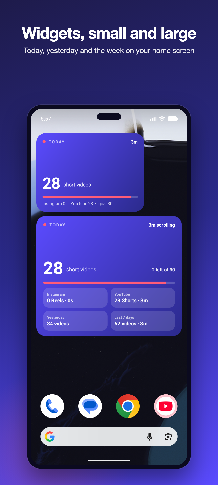
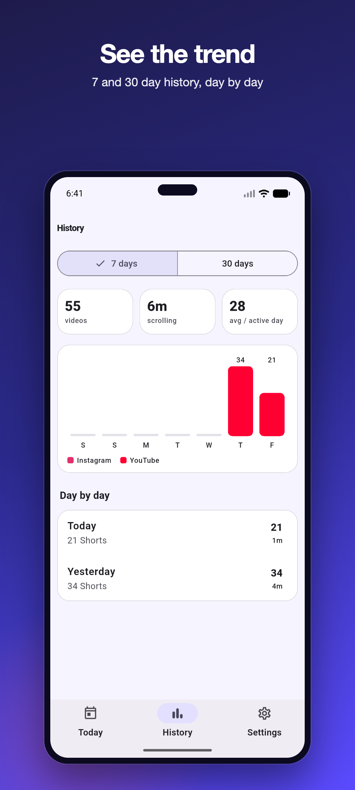

# ScrollLess

[](https://github.com/ChandraChaan/scroll-less/releases/latest)
[](https://github.com/ChandraChaan/scroll-less/releases)

[](LICENSE)

**How many Reels and Shorts did you watch today? ScrollLess counts them for you, privately, on your phone.**

It counts every Instagram Reel and YouTube Short you watch, times how long you scroll in each app, and shows a small live counter right on top of the feed. No account, no ads, and nothing you watch ever leaves your phone.

<p align="center">
  
  
  
  
</p>

## Download

**[Download the latest APK →](https://github.com/ChandraChaan/scroll-less/releases/latest)**

| File | For |
|---|---|
| `ScrollLess-<version>-arm64-v8a.apk` | Almost every phone from the last 6–7 years (pick this if unsure) |
| `ScrollLess-<version>-armeabi-v7a.apk` | Older 32-bit phones |
| `ScrollLess-<version>-universal.apk` | Any phone (bigger download) |

Open the file on your phone and allow installing from your browser or file manager when Android asks. Each release lists SHA-256 checksums, and every APK is signed with the same release key, so future versions install as updates.

## Set up in a minute

1. Install, open ScrollLess, tap **Open accessibility settings**, enable
   *ScrollLess* under Installed / Downloaded apps.
2. Open Instagram Reels or YouTube Shorts. The floating pill shows today's
   count and scrolling time for that app; the dashboard updates live.
3. Toggle the floating counter, reset today or delete all data from
   *Settings* in the app.

## What you get

- **Automatic counting:** each new Reel or Short counts once. Quick swipe-pasts (under 2 seconds, adjustable), scrolling back, or expanding a caption don't inflate the number.
- **Time per app:** how long the Reels/Shorts viewer was open, and how long you were in Instagram or YouTube at all.
- **Live floating counter** over the feed, colour-coded against your daily goal. Drag it anywhere or turn it off.
- **Home-screen widgets** (small and large) with today's count, time and goal progress.
- **History** for the last 7 and 30 days, plus a list of recent detections so you can see exactly what was counted.
- **Light and dark themes.**

## Privacy

- Everything is stored **only on your phone**, in a local database. No account, no sync, no analytics, no ads.
- ScrollLess reads **only the Instagram and YouTube screens**. Other apps are never inspected.
- It never stores what you watched: each detection keeps a short hash of the on-screen words, not the words.
- The only thing that can leave your phone is an anonymous crash report if the app crashes.
- Delete today's data or everything with one tap in Settings.

### Why it needs the Accessibility permission

Android doesn't tell apps what you're watching in other apps. An accessibility service is the only way to notice that a new Reel or Short has appeared on screen. ScrollLess explains this before asking, uses it only for Instagram and YouTube, and the code that does it is all here: [`ScrollLessAccessibilityService`](android/app/src/main/kotlin/dev/chandra/scroll_less/service/ScrollLessAccessibilityService.kt) and [how counting works](docs/LIMITATIONS.md).

## How accurate is it?

Instagram and YouTube have no API for this, so counting is based on what's on screen. It's designed to **never double-count**; the usual error is an occasional missed video. YouTube Shorts counting is tested on an emulator; Instagram Reels relies on the same approach and is the one to report problems with. See [known limitations](docs/LIMITATIONS.md).

Found a miscount? [Open an issue](https://github.com/ChandraChaan/scroll-less/issues) with your phone model and app versions, or share ideas in [Discussions](https://github.com/ChandraChaan/scroll-less/discussions).

## For developers

ScrollLess is a Flutter app with a native Kotlin accessibility service. Pull requests are welcome.

### How it works

| Layer | What it does |
| --- | --- |
| `ScrollLessAccessibilityService` (Kotlin) | Receives window events for Instagram and YouTube, classifies whether the full-screen Reels/Shorts viewer is showing, fingerprints the page under the screen centre and feeds it to the detector. Also times foreground / Reels-surface usage per app. |
| `SurfaceClassifier` | Finds the vertical pager by known view ids (`clips_viewer_*`, `reel_recycler`) and falls back to layout heuristics (near-full-screen scrollable with Reels/Shorts markers) when ids change. |
| `FingerprintBuilder` + `ReelDetector` | Turns the visible words of a page (creator, caption, audio) into a token set, ignores counters/timestamps/UI chrome, and counts a video only when a *new* page has stayed on screen for the minimum watch time (default 2 s, adjustable in Settings), is not similar to the current one, and has not been counted recently. See [docs/LIMITATIONS.md](docs/LIMITATIONS.md). |
| `UsageTracker` | Attributes elapsed time to the active app and to the Reels/Shorts surface; discards gaps when the service was not observing. |
| `OverlayController` | Draggable floating pill (`TYPE_ACCESSIBILITY_OVERLAY`, so no "draw over other apps" permission) showing today's count and time for the app you are in. Tap opens ScrollLess. |
| `StatsDatabase` (Kotlin) / `SqliteStatsRepository` (Dart) | One SQLite file, `scrollless.db`: `daily_stats(day, package, reels, surface_ms, foreground_ms)` and `reel_events(ts, day, package, fingerprint, confidence)`. Kotlin writes, Flutter reads through `sqflite`; live updates reach Flutter over an `EventChannel`. |
| Flutter app | Onboarding → guided Setup screen (accessibility disclosure, add-widget flow, daily goal), three tabs (Today with animated count and goal ring, History with 7/30-day charts, Settings), live banner, per-app cards, recent detections with confidence, overlay toggle, reset / delete, in-app privacy policy, light and dark themes. |
| `TodayWidgetProvider` / `TodayWidgetLargeProvider` (Kotlin) | Small (2×2) and large (4×3) home-screen widgets, each resizable with size-aware layouts (today's count, per-app split, time, goal progress; tap opens the app). Refreshed by the service after each count and once a minute, by the app on data/goal changes, and by the launcher every 30 min. Pinned from inside the app with `requestPinAppWidget`. |

### Build

Requirements: Flutter 3.44+, JDK 17, Android SDK 36.

```bash
flutter pub get
flutter analyze
flutter test                                # Dart unit + widget tests
(cd android && ./gradlew :app:testDebugUnitTest)   # Kotlin detector tests
flutter build apk --release
```

#### Release signing

`android/app/build.gradle.kts` reads `android/key.properties` (git-ignored):

```
storeFile=keystore/scrollless-release.jks
storePassword=…
keyAlias=scrollless
keyPassword=…        # must equal storePassword for PKCS12 keystores
```

Without that file release builds fall back to the debug key so the project
still compiles on other machines. Never commit the keystore or the
properties file; both are covered by `.gitignore`.

#### Firebase

Project `scroll-less-chandra`, Android app `dev.chandra.scroll_less`.
`lib/firebase_options.dart` and `android/app/google-services.json` are
Firebase *client* configuration (identifiers, not credentials) and are
committed so the project builds from a clean clone. Crashlytics is wired via
the `com.google.firebase.crashlytics` Gradle plugin (mapping files are
uploaded on release builds) and `firebase_crashlytics` in Dart.

Distribute a build to testers:

```bash
firebase appdistribution:distribute build/app/outputs/flutter-apk/app-release.apk \
  --app 1:687567897909:android:514ba8205b2dfcb911f87c \
  --groups testers --release-notes "…"
```

### Play Store release

Everything needed for the listing lives under `store/`: signed AAB/APK and
checksums (`store/release/`, git-ignored binaries), icon and feature graphic
(`store/graphics/`), framed phone screenshots (`store/screenshots/phone/`),
listing text and policy answers (`store/listing/`), the hosted privacy policy
source (`store/hosting/`, deployed to https://scroll-less-chandra.web.app/privacy)
and the step-by-step [publish checklist](store/PUBLISH_CHECKLIST.md).
Brand sources are in `assets/brand/`; launcher icons and the Android 12 splash
are generated with `flutter_launcher_icons` and `flutter_native_splash`
(configuration in `pubspec.yaml`).

### Test status

| Suite | Count | Result |
| --- | --- | --- |
| Kotlin JVM unit tests (`:app:testDebugUnitTest`) | 33 | pass |
| Flutter unit + widget tests (`flutter test`) | 17 | pass |
| `flutter analyze` | – | no issues |
| Live YouTube Shorts run on a Pixel 7 emulator (release APK) | 7 scenarios | pass, see docs/LIMITATIONS.md |
| Crashlytics end-to-end (test crash → issue) | 2 builds | 1.0.0 and 1.1.0 (3) both confirmed via the Crashlytics API |

## License

MIT. See [LICENSE](LICENSE).
